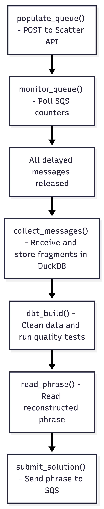
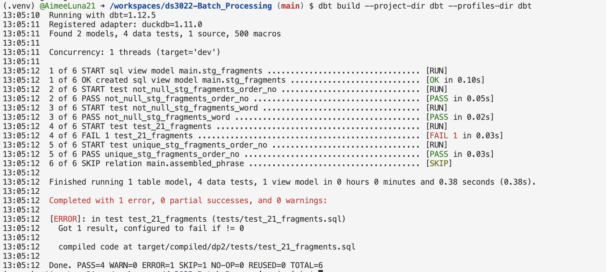
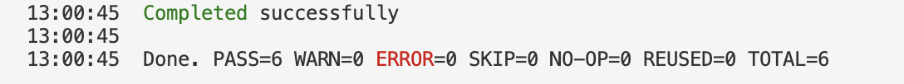
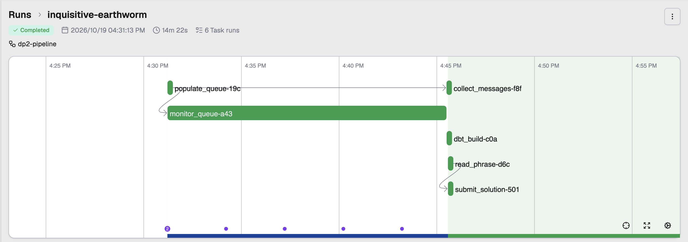

# DS 3022 Data Project 2 (Fall 2026): The SQS Puzzle

This data project is a puzzle. Your goal is to put the pieces back together in the right order.

You will write a **Prefect** data pipeline that retrieves 21 messages from an SQS queue, parses their contents, and reassembles a complete phrase from the fragments, one word per message. Your pipeline can run a single time to produce a complete result, or it can run on a schedule. Design your workflow however you see fit. You can run it as many times as you like while testing.

> Adapted from Neal Magee's Fall 2025 Data Project 2 (UVA). The puzzle is the same. Two things are new this year:
> 1. **The queue runs on your laptop.** A free SQS emulator replaces AWS, so you need no AWS account or credentials. Your code is still ordinary `boto3`: one environment variable (`AWS_ENDPOINT_URL_SQS`) decides whether it talks to your laptop or to real AWS.
> 2. **dbt is the quality gate.** Fragments are landed in DuckDB, and a dbt model reassembles the phrase. dbt tests must pass before your flow is allowed to submit.

**Due:** Monday 19 October 2026, **23:59** (Lesson 11 that afternoon is a working session: evidence run, chaos round and independent build time with instructor help). **Weight:** 20%.

Before anything else, follow **[SETUP.md](SETUP.md)** until `python kit/smoke_test.py` prints `Emulator OK`. SETUP.md also explains the four terminals you keep open while you work.
Work through **[CHECKPOINTS.md](CHECKPOINTS.md)**, check your work against **[RUBRIC.md](RUBRIC.md)**, and keep **[PROGRESS.md](PROGRESS.md)** up to date.

## Architecture

```
POST /api/scatter/<UVA_ID>          (kit/scatter_api.py, your laptop)
        |
        v
SQS queue <UVA_ID>  -- 21 messages, each delayed 30-900 s --
        |
        v
Prefect flow  (prefect-flow.py)
   monitor counters -> receive -> land in DuckDB raw.fragments -> delete
        |
        v
dbt build  (dbt/)
   stg_fragments (typed, de-duplicated) -> tests -> assembled_phrase
        |
        v
send_message to queue dp2-submit  ->  python kit/check_submission.py  ->  receipt code
```

## Task 1: Populate your SQS queue

Make an HTTP `POST` request to the scatter API with your UVA computing ID (the scatter API must be running, see SETUP.md):

```
http://127.0.0.1:8000/api/scatter/<UVA_ID>
```

```python
import requests

url = "http://127.0.0.1:8000/api/scatter/mst3k"
payload = requests.post(url).json()
```

```python
import httpx

url = "http://127.0.0.1:8000/api/scatter/mst3k"
payload = httpx.post(url).json()
```

The response gives you your queue URL:

```
>>> payload
{'hello': 'mst3k', 'sqs_url': 'http://127.0.0.1:9324/123456789012/mst3k', 'messages': 21, 'mode': 'fast (5-60s delays)'}
```

Your request sends exactly **21** messages to your queue, each with a random `DelaySeconds` between **30 and 900 seconds** (5 to 60 seconds while `DP2_FAST=1`, for development). **Keep these delays in mind as your pipeline proceeds to the next task.**

**NOTE:** Do not repeat this POST if your pipeline runs more than once (for example on a schedule) or inside a retry loop. Each POST empties your queue and sends all 21 messages again.

## Task 2: Monitor your queue, then collect, land and delete

Track how many messages are waiting with `get_queue_attributes()`. Three values count messages, and together they make up the total:

- `ApproximateNumberOfMessages` (visible, ready to receive)
- `ApproximateNumberOfMessagesNotVisible` (received by someone, not yet deleted)
- `ApproximateNumberOfMessagesDelayed` (still hidden by their delay)

Decide on a strategy for how and when to pick up messages, explain it in your README, and code it.

Each message has a `Body` containing the same meaningless word. The meaningful content is in `MessageAttributes`. Ask for it explicitly with `MessageAttributeNames=["All"]`, then read each attribute's `StringValue`:

```python
msg = resp["Messages"][0]
order_no = msg["MessageAttributes"]["order_no"]["StringValue"]   # a string, not an int
word     = msg["MessageAttributes"]["word"]["StringValue"]
```

Requirements:

- **Land every fragment in DuckDB** (default file `dp2.duckdb`, table `raw.fragments` with at least `order_no`, `word`, `received_at`) **before** you delete its message.
- Delete each message with its `ReceiptHandle` after storing it. Your pipeline must receive, store and delete **all** messages. Leave no "dangling" messages behind.
- Handle empty or delayed responses gracefully. When nothing is visible, `receive_message` returns a response **without** a `Messages` key; your pipeline must not crash on it.
- Use a timeout so the pipeline fails clearly, rather than hanging forever, if fragments never arrive.

## Task 3: Reassemble with dbt, then submit

Build the phrase with dbt inside `dbt/` (the project, profile and source are already set up):

- `models/staging/stg_fragments.sql`: cast `order_no` to an integer and clean `word`. Make this robust to a fragment being stored twice.
- `models/staging/schema.yml`: generic tests (`not_null`, `unique`, ...) on its columns.
- `tests/`: at least one singular test that fails unless there are exactly 21 fragments with no gaps in the order numbers.
- `models/marts/assembled_phrase.sql`: one row containing the phrase in order.

Your flow runs `dbt build --project-dir dbt --profiles-dir dbt` (or `dbtRunner` from `dbt.cli.main`) and **must not submit if dbt fails**.

Example of ordering:

```
order_no   word
--------   -----
3          brown
2          quick
4          fox.
1          The
```

gives "The quick brown fox."

Submit your phrase as a message to the separate queue **`dp2-submit`**, with your computing ID and the platform used (`"prefect"`) as message attributes:

```python
def send_solution(uvaid, phrase, platform):
    url = sqs.get_queue_url(QueueName="dp2-submit")["QueueUrl"]
    response = sqs.send_message(
        QueueUrl=url,
        MessageBody="dp2 solution",
        MessageAttributes={
            "uvaid":    {"DataType": "String", "StringValue": uvaid},
            "phrase":   {"DataType": "String", "StringValue": phrase},
            "platform": {"DataType": "String", "StringValue": platform},
        },
    )
    ...
```

Check and log that the response has HTTP status `200`. Then run:

```
python kit/check_submission.py
```

and paste the **receipt code** it prints into your README.

You may observe and rerun your pipeline as often as you like, but in the end your code must fetch, store, test, reassemble and submit without human intervention. You may not receive messages or sort fragments by hand.

## Notes and submission

1. Fork the assignment repository and push your work to your fork.
2. Your Prefect flow lives in `prefect-flow.py`. Secondary flows (subflows) are allowed.
3. Use Prefect's built-in logging. Do not commit log files.
4. Do not commit data, `.duckdb` files, `dbt/target/` or `.env` (the provided `.gitignore` handles this).
5. Do not edit the files in `kit/`: they are the same for everyone and are used to check your submission.
6. Your **README must include**: how to set up and run your pipeline; your polling strategy and why; how your dbt tests protect the result (with a screenshot of a test failing on purpose and then passing); a Prefect dashboard screenshot of one **full-delay run** (`DP2_FAST=0`); your receipt code; and a "Chaos round" section (Lesson 11).
7. Submit the repository link and your self-assessed **[RUBRIC.md](RUBRIC.md)**. Your README is where you explain and defend your design (25% of the grade).

## Reference

- [Working with SQS: practical examples (Neal Magee)](https://github.com/nmagee/learn-sqs)
- [boto3 SQS client documentation](https://boto3.amazonaws.com/v1/documentation/api/latest/reference/services/sqs.html)
- [Prefect documentation](https://docs.prefect.io/v3/get-started)
- [dbt-duckdb adapter](https://github.com/duckdb/dbt-duckdb) and [dbt data tests](https://docs.getdbt.com/docs/build/data-tests)
- [Moto server mode](https://docs.getmoto.org/en/latest/docs/server_mode.html), [ElasticMQ](https://github.com/softwaremill/elasticmq)


## Architecture

### Prefect Flow DAG

The diagram below shows the tasks in my Prefect pipeline.



## Polling Strategy

For this project, I used a polling strategy to monitor messages arriving in the SQS queue. The monitor_queue() task calls get_counts() every 5 seconds to check three message counters: visible, in-flight, and delayed.

I chose a 5-second interval because the messages arrive at random times, and checking every 5 seconds allows me to track their progress without constantly requesting updates from SQS.

The monitoring task stops when the delayed-message count reaches zero, meaning all scheduled messages have been released. I also included a 1,200-second (20-minute) timeout to prevent the task from running indefinitely if messages do not arrive.

I considered checking the queue continuously without waiting, but rejected that approach because it would make unnecessary API requests. Polling every 5 seconds provides a reasonable balance between responsiveness and efficiency.

## DuckDB Storage and dbt Quality Checks

I used DuckDB to store the message fragments before deleting them from the SQS queue. Each fragment was saved in the `raw.fragments` table with its order number, word, and timestamp. I made sure the data was stored before deleting the corresponding message to reduce the risk of losing information.

After collecting all 21 fragments, my Prefect flow runs `dbt build` to clean, validate, and reconstruct the phrase.

The `stg_fragments` model converts the order numbers into integers, removes invalid entries, and handles duplicate order numbers. I included dbt tests to check that order numbers and words are not null, that order numbers are unique, and that there are exactly 21 fragments numbered from 1 through 21.

The `assembled_phrase` model combines the words in the correct numerical order to reconstruct the original sentence.

### Testing the Quality Checks

To confirm that my dbt tests worked, I intentionally removed one fragment from DuckDB and ran `dbt build`. The test failed because only 20 fragments remained.



I then restored the missing fragment and ran the tests again. All six dbt build steps passed successfully.



This demonstrates that the quality checks prevent an incomplete phrase from being submitted. My Prefect pipeline only continues to the submission task if `dbt build` completes successfully.

## Full-Delay Pipeline Run

I tested my complete Prefect pipeline with `DP2_FAST=0`,
which uses the normal SQS message delays of 30–900 seconds.

The flow `inquisitive-earthworm` completed successfully
on October 19, 2026, in 14 minutes and 22 seconds.

All six Prefect tasks completed successfully. The pipeline
collected all 21 fragments, passed all dbt quality checks,
reconstructed the correct phrase, and submitted the result
with HTTP status 200.



## Verified Submission

The complete Prefect pipeline successfully generated, collected,
stored, tested, reconstructed, and submitted all 21 message fragments.

- UVA computing ID: `xdd9uz`
- Platform: `prefect`
- Submission HTTP status: `200`
- Verification result: `PASS`
- Receipt code: `43D5269990`

The submission was verified using:

`python kit/check_submission.py`

The checker confirmed that 1/1 submissions were correct.


## Chaos Mode Testing

I tested the pipeline twice with `DP2_FAST=1` and `DP2_CHAOS=1`. Both Prefect flow runs completed successfully.

Chaos mode generated 24 messages instead of the usual 21. These included 21 valid fragments, two duplicate fragments, and one malformed message.

During collection, my code checked each message for the `order_no` and `word` attributes. If an attribute was missing, the message was logged as malformed and deleted from SQS. Valid fragments were saved to DuckDB before their SQS messages were deleted.

To handle duplicates, I counted distinct `order_no` values instead of counting every received message. My dbt staging model also removes duplicate order numbers before reconstructing the phrase.

The main issue chaos mode introduced was that receiving 21 messages did not necessarily mean I had collected all 21 unique fragments. I fixed this by continuing to receive messages until DuckDB contained 21 distinct order numbers and all SQS queue counters were zero.

### Chaos Test Results

- **Run 1:** `curly-honeybee` — Completed; 21 unique fragments; all SQS counters zero; dbt PASS=6; submission HTTP 200.
- **Run 2:** `abiding-narwhal` — Completed; 21 unique fragments; all SQS counters zero; dbt PASS=6; submission HTTP 200.
- **Submission verification:** `2/2 submission(s) correct`.
- **Receipt:** `43D5269990`.

Both runs reconstructed the correct phrase and handled duplicate and malformed messages without failing.
  

## How to Run My Pipeline

My project uses Prefect to manage the workflow, Moto to emulate AWS SQS, DuckDB to store the message fragments, and dbt to clean and test the data.

### 1. Set Up the Environment

Clone the repository and open it in GitHub Codespaces.

Follow the instructions in [SETUP.md](SETUP.md) to create the Python virtual environment, install the required packages, and configure the `.env` file.

Set `UVA_ID` to your computing ID and make sure the local SQS endpoint is configured.

### 2. Start the Services

Open four terminals in Codespaces:

- **Terminal 1:** Start Moto using `moto_server -p 9324`.
- **Terminal 2:** Start the Scatter API using `python kit/scatter_api.py`.
- **Terminal 3:** Activate the virtual environment and use it to run the pipeline.
- **Terminal 4:** Start Prefect using `prefect server start`.

Configure Prefect to use the local server:

```bash
prefect config set PREFECT_API_URL=http://127.0.0.1:4200/api
```

Keep the three service terminals running.

### 3. Verify the Environment

In Terminal 3, run:

```bash
python kit/smoke_test.py
```

The smoke test should display `Emulator OK`.

### 4. Run the Pipeline

For faster testing, set these values in `.env`:

```env
DP2_FAST=1
DP2_CHAOS=0
```

Run the complete pipeline:

```bash
python prefect-flow.py
```

The pipeline automatically generates the messages, waits for their delays, collects and stores the fragments, runs dbt quality checks, reconstructs the phrase, and submits the answer.

For full-delay testing, set `DP2_FAST=0`. For chaos testing, set `DP2_CHAOS=1` and restart the Scatter API so it loads the updated settings.

### 5. Verify the Submission

After the pipeline completes, run:

```bash
python kit/check_submission.py
```

This checks whether the submitted phrase is correct and displays the receipt code.